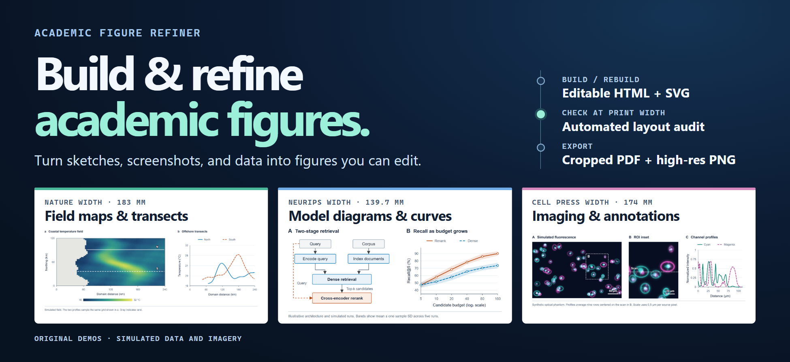

# Academic Figure Refiner



**Turn a sketch, screenshot, or dataset into an editable paper figure.** Build and revise in HTML/CSS/SVG, check the layout at manuscript width, and export a tightly cropped PDF and high-resolution PNG.

- **Revise the figure at its final size.** Set the manuscript column width once, then edit the panels, labels, and source data without flattening the figure.
- **Keep the evidence traceable.** Generate plots from their source values and keep raster evidence separate from SVG overlays. The skill calls out approximations when a screenshot is the only source.
- **Catch layout issues before handoff.** Audit rendered SVG font sizes, clipping, overlapping labels, and broken images. Then inspect the export or use [Lavish](https://github.com/kunchenguid/lavish-axi) for click-to-annotate review.

## See what it makes

These original demos use simulated data and imagery. Each has editable source and PDF/PNG exports generated with the bundled exporter.

| Layout | What the example shows | Open or download |
| --- | --- | --- |
| **Nature · 183 mm** | A coastal temperature heatmap with two profiles sampled from the same grid | [Source](examples/nature) · [PDF](examples/nature/exports/figure.pdf) · [PNG](examples/nature/exports/figure.png) |
| **NeurIPS · 139.7 mm** | A vector retrieval architecture and recall scaling from five simulated runs per budget | [Source](examples/neurips) · [PDF](examples/neurips/exports/figure.pdf) · [PNG](examples/neurips/exports/figure.png) |
| **Cell Press · 174 mm** | A simulated fluorescence image with an inset, calibrated scale bars, and two intensity profiles | [Source](examples/cell) · [PDF](examples/cell/exports/figure.pdf) · [PNG](examples/cell/exports/figure.png) |

## Install

```bash
npx skills add KLOSYX/academic-figure-refiner
```

For a manual install, clone the repository into the skills directory your client reads. For example:

```bash
git clone https://github.com/KLOSYX/academic-figure-refiner.git ~/.agents/skills/academic-figure-refiner
```

## Try it

Give your agent the sketch, reference, or data, and specify the target width and the key elements to preserve.

```text
Use the academic-figure-refiner skill to build a 139.7 mm NeurIPS figure.
Put the retrieval architecture in panel A and plot recall at each candidate
budget from results.csv in panel B. Audit the figure and export PDF and PNG.
```

```text
使用 academic-figure-refiner 技能，把这张草图重绘成 183 mm 的 Nature 双栏图。
保留原始数据、坐标轴、单位和分组标签。交付可编辑的 HTML/SVG、PDF 和 300 DPI PNG。
```

The skill includes layouts for Nature, Science, Cell Press, NeurIPS, ICML, ICLR, CVPR, and IEEE formats. Its recipes cover mechanism and behavioral diagrams, AI/ML architectures and agent pipelines, scaling and ablation charts, heatmaps, and neuroscience or microscopy panels.

## Audit and export

Install Python 3 and Playwright. The exporter can use local Google Chrome or Playwright Chromium.

```bash
python -m pip install playwright
# If you do not have a compatible local browser:
python -m playwright install chromium

python scripts/export_figure.py examples/nature/index.html --dpi 300 --pad-mm 0.5
python scripts/export_figure.py examples/nature/index.html --audit-only
```

The exporter writes `exports/figure.pdf` and `exports/figure.png` beside the source by default. Diagrams and labels stay vector-based in the PDF, and image panels are embedded as rasters. Use `--format pdf|png|both`, `--out-dir`, or `--dpi 600` to suit the figure.

Open the PNG at its intended size for a visual check. You can also open the HTML locally or run `npx -y lavish-axi path/to/index.html` for interactive review. Re-run the exporter after editing.

## Project files

- [Skill instructions](SKILL.md) and [HTML/CSS starter](assets/html-figure-template)
- [Venue widths and typography](references/academic-standards.md) and [figure recipes](references/figure-recipes.md)
- [Scientific integrity](references/scientific-integrity.md) and [HTML workflow](references/html-figure-workflow.md)
- [Exporter and layout audit](scripts/export_figure.py) and [demo reproduction](examples/README.md)
